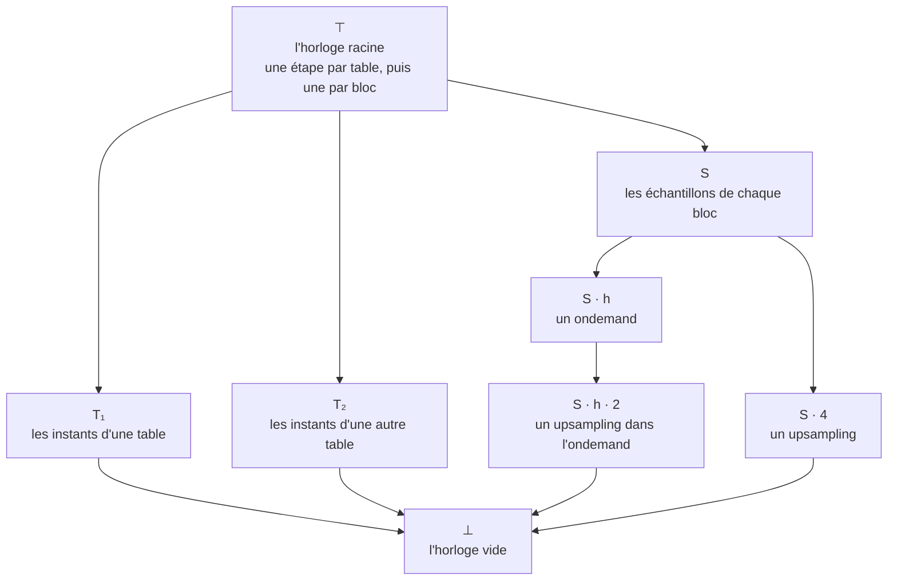

::: toc+
- **Objet et statut** — ce que le document définit, et sa suite.
- **Les repères temporels** — du monorate aux horloges.
- **Parent et cadence** — ce qui définit une horloge.
- **L'horloge racine** — l'horloge qui est son propre parent, de cadence 1.
- **La remontée** — convertir le temps du parent en temps de l'enfant, et inversement.
- **Sélection et subdivision** — les deux cas remarquables.
- **Les étapes du programme** — les tables, puis les blocs.
- **Les ancêtres** — la chaîne d'une horloge, et le treillis.
- **Parenté avec les langages synchrones** — ce qui est repris.
- **Décisions** — ce qui est pris.
:::

# Objet et statut

Ce document définit les horloges qui serviront de base à `ondemand`, `upsampling` et `downsampling` sur la lignée `master-dev-certification`. Il ne parle que du temps : tout y est construit sur ℕ, sans signaux. Sa suite, `clocked-signals.md`, pose les signaux sur ces horloges.

Décision du 13 novembre : on spécifie, on n'implémente pas. L'implémentation ne commencera qu'après la bascule de `master-dev` sur la branche de certification. Le but de la spécification est d'être simple, régulière, et de proposer les bonnes abstractions.

La marque **[D]** signale une décision prise.

Sources : `spec.md` (ondemand v5), les documents Expressive E, les slides IFC-24.

# Les repères temporels

Dans la version monorate de Faust, la question du temps ne se pose pas : tous les calculs audio sont faits à chaque échantillon. Un signal a une valeur par échantillon, et l'instant t d'un signal est aussi l'instant t de tous les autres.

Avec `ondemand`, `upsampling` et `downsampling`, ce n'est plus vrai. Un calcul peut n'être fait qu'à certains échantillons, quand on le demande, ou au contraire plusieurs fois pendant le même échantillon. Il faut donc un moyen de dire à quels instants un calcul est fait. C'est le rôle de l'**horloge**.

Une horloge est un **repère temporel**. À l'intérieur d'un repère, le temps reste aussi simple qu'en monorate : c'est une suite d'**instants**, numérotés 0, 1, 2, etc. Mais chaque repère a son propre temps : l'instant 5 de l'un et l'instant 5 d'un autre n'ont a priori aucun rapport. Ce qui est nouveau, c'est donc qu'il y a plusieurs repères, et qu'il faut pouvoir passer de l'un à l'autre.

Les repères ne sont pas indépendants : ils s'emboîtent. Une zone de calcul, le corps d'un `ondemand` par exemple, a son propre repère. Ce repère est lui-même placé dans celui du programme qui l'entoure, qui peut à son tour être placé dans un autre, et ainsi de suite. Les repères forment une **hiérarchie**, où chacun a un parent. À sa racine se trouve un repère unique, sur lequel tous les autres sont construits.

On passe toujours d'un repère à son parent. Il suffit pour cela de savoir combien d'instants du repère ont lieu pendant chaque instant du parent : un seul ou aucun pour un `ondemand`, plusieurs pour un `upsampling`. On en déduit, pour chaque instant du repère, l'instant du parent pendant lequel il a lieu. De proche en proche, on remonte ainsi de n'importe quel repère jusqu'à ceux qui le contiennent.

La section « Les étapes du programme » dit quelles horloges a un programme Faust : elle nomme ce qui occupe les étapes, les tables et les blocs.

# Parent et cadence

Une horloge est donnée par deux choses : le repère dans lequel elle est placée : son horloge parente, et le nombre de ses instants qui ont lieu pendant chaque instant de celle-ci : sa cadence.

::: definition [Horloge]
Le temps d'une **horloge** est ℕ : ses instants sont les entiers 0, 1, 2, etc. Toute horloge c a :

- un **parent**, parent(c), qui est une horloge ;
- une **cadence**, cadence(c), qui est une fonction de ℕ dans ℕ sur le temps de son parent : cadence(c)(t) est le nombre d'instants de c qui ont lieu pendant l'instant t de parent(c).

Deux horloges sont **égales** quand elles ont le même parent et la même cadence. C'est ici une égalité de fonctions. Dans un programme, où la cadence est un signal, elle est décidée sur les arbres : c'est l'objet de `clocked-signals.md`.
:::

On note p · r l'horloge dont le parent est p et la cadence r :

```math
\mathit{parent}(p · r) = p \qquad \mathit{cadence}(p · r) = r
```

Toute horloge s'écrit ainsi : c = parent(c) · cadence(c).

# L'horloge racine

Toute horloge est construite sur une autre, son parent. Il en faut donc une première pour amorcer le système : une horloge sur laquelle toutes les autres sont construites. Pour que la définition précédente s'applique aussi à elle, sans cas particulier, on en fait son propre parent.

::: definition [Horloge racine]
L'**horloge racine**, notée ⊤, est l'horloge qui est son propre parent et dont la cadence vaut 1 à chaque instant :

```math
\mathit{parent}(⊤) = ⊤ \qquad \mathit{cadence}(⊤) = 1 \qquad\text{c'est-à-dire}\qquad ⊤ = ⊤ · 1
```

Toute horloge atteint ⊤ en un nombre fini de passages au parent.
:::

La fonction parent est ainsi définie partout, et l'horloge racine en est le seul point fixe. C'est la convention de la racine d'un système de fichiers, qui est son propre répertoire parent.

Son temps n'est pas déduit d'un autre : il est donné, et c'est l'hôte qui le fait avancer.

Le nombre de passages au parent qu'il faut pour atteindre ⊤ est la **profondeur** de l'horloge. Une horloge de profondeur k s'écrit ⊤ · r₁ · r₂ · … · rₖ : elle est déterminée par la suite de ses cadences.

# La remontée

La cadence d'une horloge dit combien d'instants ont lieu pendant chaque instant de son parent.

Il est donc facile de convertir le temps du parent en temps de l'enfant : il suffit d'additionner. Soit c une horloge, p son parent et r sa cadence. À la fin de l'instant t de p, le nombre d'instants de c qui ont eu lieu est

```math
\mathit{fait}(t) = r(0) + r(1) + … + r(t)
```

Le temps de c, à la fin de l'instant t de son parent, est donc fait(t) − 1 : c'est le dernier instant de c qui a eu lieu. Tant que la cadence est restée nulle, fait(t) vaut 0 et ce temps vaut −1 : l'horloge n'a pas encore commencé à tourner, et son temps est négatif.

Avec cette fonction, on trouve la conversion inverse : à quel instant du parent correspond un instant de l'enfant.

::: definition [Remontée]
La **remontée** π de c associe à chaque instant n de c l'instant de son parent pendant lequel il a lieu : π(n) est le plus petit t tel que fait(t) > n.
:::

La remontée est croissante. La cadence et la remontée disent la même chose : r(t) est le nombre d'instants n tels que π(n) = t.

Un premier exemple, avec la cadence 1, 0, 3, 1 :

```
instant t de l'horloge parente p :   0     1     2           3
cadence r(t) de l'horloge c      :   1     0     3           1
fait(t)                          :   1     1     4           5
temps de l'horloge c             :   0     0     3           4
instants n de l'horloge c        :   0           1  2  3     4
remontée π(n)                    :   0           2  2  2     3
```

Pendant l'instant 1 du parent il ne se passe rien. Pendant l'instant 2 ont lieu trois instants de l'horloge.

Un second exemple, où la cadence commence par 0 :

```
instant t de l'horloge parente p :   0     1     2     3
cadence r(t) de l'horloge c      :   0     0     1     2
fait(t)                          :   0     0     1     3
temps de l'horloge c             :  -1    -1     0     2
instants n de l'horloge c        :               0     1  2
remontée π(n)                    :               2     3  3
```

Pendant les deux premiers instants du parent, l'horloge n'a pas commencé : son temps vaut −1. Son instant 0 a lieu pendant l'instant 2 du parent : rien n'oblige une horloge à commencer en même temps que son parent. C'est le cas d'un `ondemand` qui n'a pas encore reçu de demande.

Pour l'horloge racine, la cadence vaut 1 partout : fait(t) = t + 1, et la remontée est l'identité. La définition générale s'applique donc aussi à ⊤, sans cas particulier.

Si la cadence est nulle à partir d'un certain instant, l'horloge n'a qu'un nombre fini d'instants : son temps est un début de ℕ.

# Sélection et subdivision

Deux cas sont remarquables.

Sélection
:   La cadence ne vaut jamais plus de 1. Il n'y a jamais deux instants pendant le même instant du parent : la remontée est strictement croissante.

Subdivision
:   La cadence vaut toujours au moins 1. Il se passe quelque chose pendant chaque instant du parent : la remontée atteint tous les instants du parent.

Dans les deux exemples de la section précédente, la cadence n'est ni l'une ni l'autre. Celle de l'horloge racine est les deux à la fois.

Une horloge p · 1, dont la cadence vaut 1 partout, a le même temps que p et une remontée identité. Elle n'est pas égale à p pour autant, sauf si p est l'horloge racine : son parent est p, alors que celui de p est parent(p).

# Les étapes du programme

Le temps de l'horloge racine est la suite des **étapes** du programme : d'abord une étape par table à remplir, puis une étape par bloc. **[D]**

Prenons un programme qui a deux tables. La première à être calculée, T₁, a N valeurs. La seconde, T₂, en a M, et doit être calculée après la première. Viennent ensuite les blocs : chaque appel de la méthode `compute` en traite un, de taille B₀, puis B₁, etc.

```
étape t de l'horloge racine :   0     1     2     3     4    …
ce que l'on y calcule       :   T₁    T₂    bloc  bloc  bloc
cadence de T₁               :   N     0     0     0     0    …
cadence de T₂               :   0     M     0     0     0    …
cadence de S                :   0     0     B₀    B₁    B₂   …
```

Ces trois horloges ont l'horloge racine pour parent, et ne diffèrent que par leur cadence :

- celle de T₁ a pour cadence N, puis 0 indéfiniment : ses N instants ont tous lieu pendant l'étape 0 ;
- celle de T₂ a pour cadence 0, puis M, puis 0 indéfiniment : ses M instants ont tous lieu pendant l'étape 1, quand T₁ est remplie ;
- celle des échantillons, **S**, a pour cadence 0, 0, B₀, B₁, etc. Pendant les étapes des tables elle n'a pas commencé, et son temps vaut −1 ; elle a ensuite, pendant chaque étape, autant d'instants que le bloc a d'échantillons.

Ces horloges de profondeur 1 sont les **repères de base** :

| Repère de base | Sa cadence | Son temps |
| :--- | :--- | :--- |
| une table de taille n | n pendant l'étape de la table, 0 ailleurs | n instants |
| les échantillons, **S** | 0 pendant les étapes des tables, puis la taille de chaque bloc | infini |

Le premier échantillon n'a donc pas lieu pendant une étape d'initialisation : il a lieu pendant l'étape du premier bloc.

Sous chaque repère de base, on construit des **régions** par les mêmes dérivations : ce sont les horloges dérivées d'un repère de base ou d'une autre région, celles que créent `ondemand`, `upsampling` et `downsampling`. Le calcul ne distingue pas l'initialisation de l'exécution : seule change l'étape qui héberge le repère de base.

# Les ancêtres

Les **ancêtres** d'une horloge c sont c, parent(c), parent(parent(c)), et ainsi de suite jusqu'à ⊤. **[D]** On note c ≤ a quand a est un ancêtre de c : c est construite sur a, et chacun de ses instants a lieu pendant un instant de a. Les ancêtres d'une horloge forment une chaîne, d'elle jusqu'à l'horloge racine.

Pour remonter d'une horloge c à l'un de ses ancêtres a, on compose les remontées successives. On note π(c → a) cette remontée composée ; π(c → c) est l'identité.

Deux horloges quelconques ont toujours un plus proche ancêtre commun, puisque ⊤ est l'ancêtre de toutes. Si aucune n'est l'ancêtre de l'autre, elles sont **incompatibles** : ce que l'on calcule sur l'une et sur l'autre ne peut se rencontrer que sur cet ancêtre commun.

Pour l'ordre ≤, l'horloge racine est le plus grand élément : toutes les horloges sont construites sur elle. On ajoute en dessous de toutes un plus petit élément, noté ⊥ : l'**horloge vide**, celle qui n'a aucun instant. N'ayant aucun instant, elle est dans toutes les autres. Les horloges forment alors un **treillis** :

- la borne supérieure de deux horloges est leur plus proche ancêtre commun : la plus petite horloge qui les contient toutes les deux ;
- la borne inférieure est faite des instants qui leur sont communs. Pour deux horloges compatibles, c'est la plus profonde des deux. Pour deux horloges incompatibles, c'est ⊥ : elles n'ont aucun instant commun.

L'horloge vide n'est l'horloge d'aucun calcul : un calcul dont les arguments n'ont aucun instant commun ne peut être fait nulle part. Les règles d'horloge de `clocked-signals.md` le refusent. Elle ne se confond pas avec une horloge p · 0, de cadence toujours nulle : celle-ci n'a pas d'instant non plus, mais elle a un parent, et n'est que dans ses propres ancêtres.



Le dessin place les plus grandes horloges en haut : chaque flèche descend d'une horloge à une horloge construite sur elle. Ce sont les horloges d'un programme qui a deux tables, un `ondemand` de demande h, un `upsampling` par 4, et un `upsampling` par 2 placé dans l'`ondemand`. T₁ et T₂ sont les repères de ses tables, **S** celui des échantillons.

Les blocs n'y sont pas une horloge à part : ce sont des instants de l'horloge racine, dont le temps est fait d'une étape par table, puis d'une étape par bloc. L'horloge **S** subdivise chaque bloc en ses échantillons.

Quelques exemples lus sur ce dessin :

| Horloges | Relation | Borne supérieure | Borne inférieure |
| :--- | :--- | :--- | :--- |
| **S** et **S** · h · 2 | **S** · h · 2 ≤ **S** | **S** | **S** · h · 2 |
| ⊤ et T₂ | T₂ ≤ ⊤ | ⊤ | T₂ |
| **S** · h et **S** · 4 | incompatibles | **S** | ⊥ |
| T₁ et **S** · h · 2 | incompatibles | ⊤ | ⊥ |

# Parenté avec les langages synchrones

Ces horloges décrivent une exécution synchrone et causale, et elles reprennent des notions établies.

- Dans Lustre et Lucid Synchrone, un flot est une suite de valeurs et une horloge est un type, `base` ou `ck on c`. Notre c · r est la même construction, avec une cadence entière au lieu d'un booléen. Voir les [notes de cours de M. Pouzet sur le calcul d'horloges](https://www.di.ens.fr/~pouzet/cours/mpri/cours6/clock-calculus.pdf).
- L'égalité des horloges y est structurelle ; c'est aussi le choix de `clocked-signals.md`.
- Les domaines réactifs de ReactiveML créent une échelle de temps plus rapide en subdivisant un instant du parent, et leurs instants locaux sont inobservables de l'extérieur. C'est notre subdivision. Voir [Time Refinement in a Functional Synchronous Language](https://www.di.ens.fr/~pouzet/bib/scp15.pdf).

# Décisions

- Chaque horloge a pour temps ℕ, ou un début de ℕ. Une horloge a un parent et une cadence ; l'horloge racine est son propre parent, de cadence 1.
- Une horloge qui n'a pas commencé a pour temps −1.
- L'horloge racine a pour instants les étapes du programme : une par table, puis une par bloc. Les blocs ne sont pas une horloge à part.
- L'ordre sur les horloges se note c ≤ a quand a est un ancêtre de c. L'horloge racine ⊤ en est le plus grand élément ; l'horloge vide ⊥, qui n'a aucun instant, le plus petit.
- Spécifier d'abord ; implémenter après la bascule de `master-dev`.
